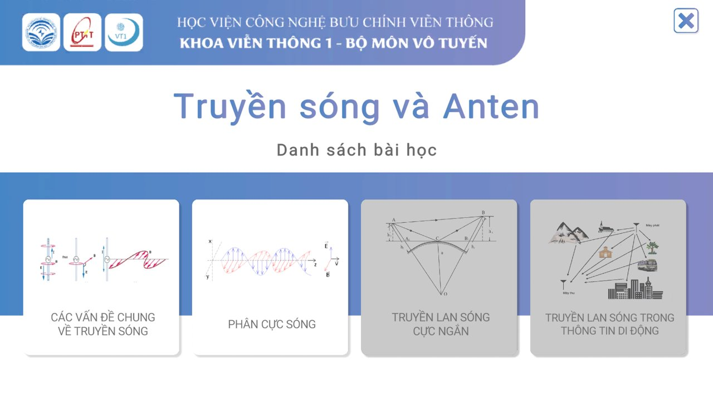
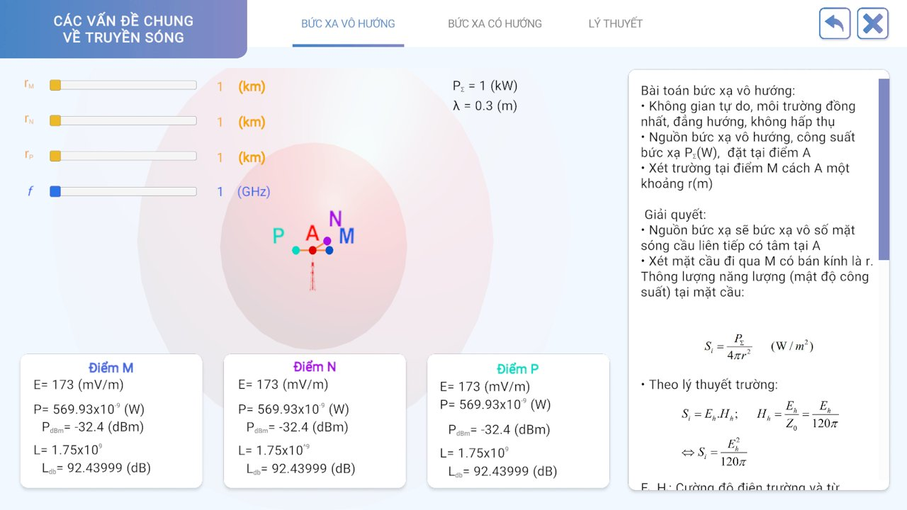
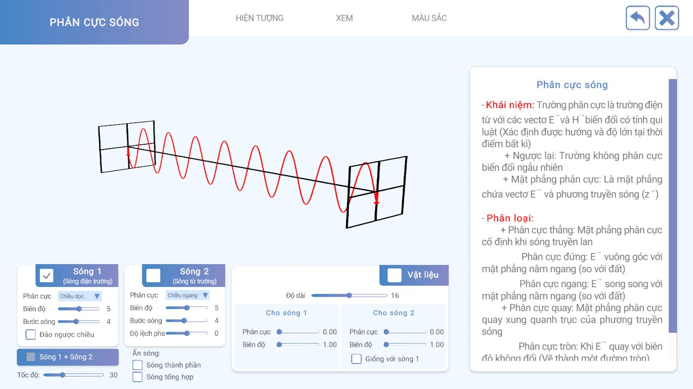
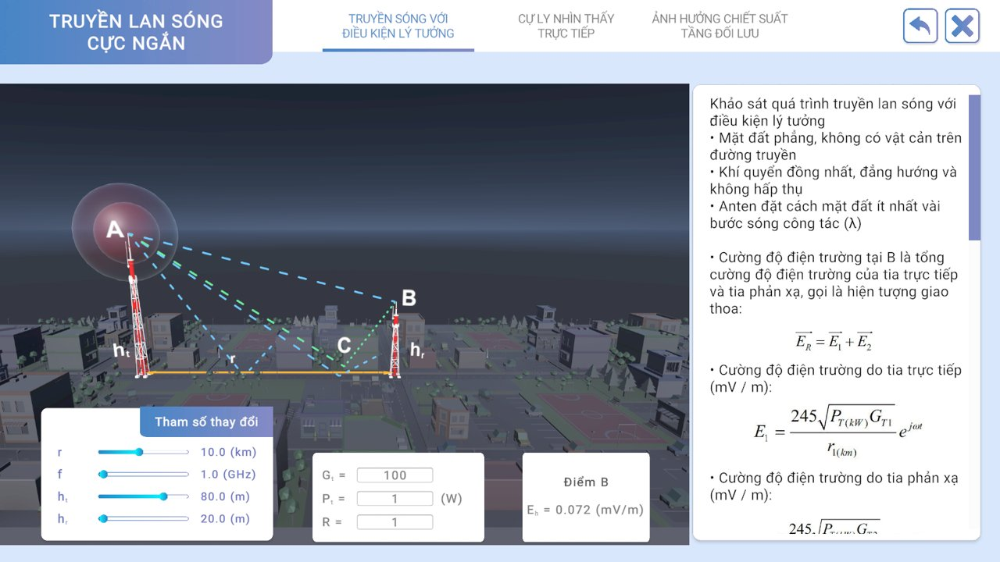
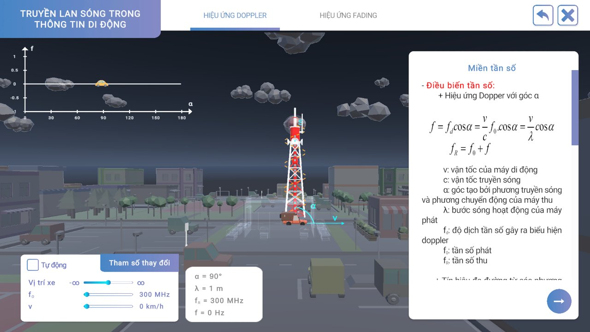
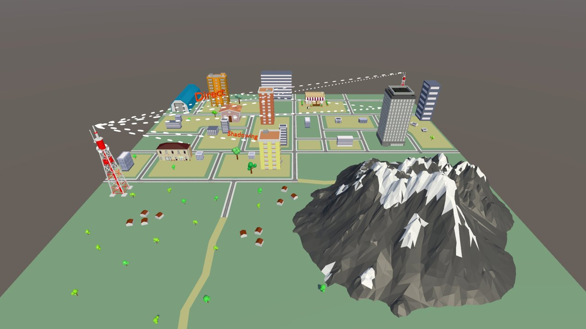

# Truyền sóng và Anten — Bài giảng mô phỏng tương tác

Bộ bài giảng mô phỏng 3D cho học phần **Truyền sóng và Anten** (Bộ môn Vô tuyến, Khoa Viễn thông 1 — Học viện Công nghệ Bưu chính Viễn thông). Người học thay đổi tham số và quan sát trực tiếp sóng điện từ, cường độ trường, tổn hao và hiệu ứng Doppler thay cho công thức trên giấy.



## Nội dung bài học

| Bài | Nội dung |
| --- | --- |
| Các vấn đề chung về truyền sóng | Bức xạ vô hướng / có hướng, mật độ công suất và cường độ điện trường tại các điểm M, N, P theo công suất phát, tần số và khoảng cách |
| Phân cực sóng | Phân cực thẳng, tròn, elip; tổng hợp hai sóng; đổi màu, tốc độ, biên độ, độ lệch pha của từng sóng |
| Truyền lan sóng cực ngắn | Tầm nhìn thẳng của anten (bán kính Trái Đất a = 6370 km), cường độ trường tại điểm thu, tổn hao truyền sóng |
| Truyền lan sóng trong thông tin di động | Hiệu ứng Doppler theo góc và vận tốc máy di động; hiệu ứng Fading |
| Mô hình 3D | Mô hình thành phố, địa hình và trạm anten để quan sát môi trường truyền sóng |

## Ảnh chụp

**Các vấn đề chung về truyền sóng**



**Phân cực sóng**



**Truyền lan sóng cực ngắn**



**Truyền lan sóng trong thông tin di động: Doppler, Fading**



**Mô hình 3D**



## Công nghệ

- Unity 2022.3 (Universal Render Pipeline), C#
- Vẽ sóng và đồ thị thời gian thực bằng LineRenderer, đường Bezier
- TextMesh Pro, Unity UI Extensions, NaughtyAttributes
- Build cho Windows và WebGL (có chế độ toàn màn hình cho WebGL)

## Chạy dự án

1. Mở thư mục dự án bằng **Unity 2022.3** (đã kiểm tra với 2022.3.62f2).
2. Thêm các scene sau vào *File → Build Settings* theo đúng thứ tự (bài học được mở theo chỉ số scene):
   1. `Assets/Scenes/HomeAnten.unity`
   2. `Assets/Scenes/Lession1.unity` … `Assets/Scenes/Lession5.unity`
3. Mở `HomeAnten` và bấm **Play**, hoặc build cho Windows / WebGL.

## Cấu trúc thư mục

```
Assets/
  Scenes/          HomeAnten và Lession1–5
  Scritps/         Code bài học (sóng, Doppler, tổn hao, điều hướng)
  PTITELEARNING/   Khung e-learning dùng chung (menu, mô hình 3D, AR)
  Resources/       Ảnh minh hoạ, icon giao diện
  Model3D/, FBX/   Mô hình 3D anten, thành phố, Trái Đất
```
